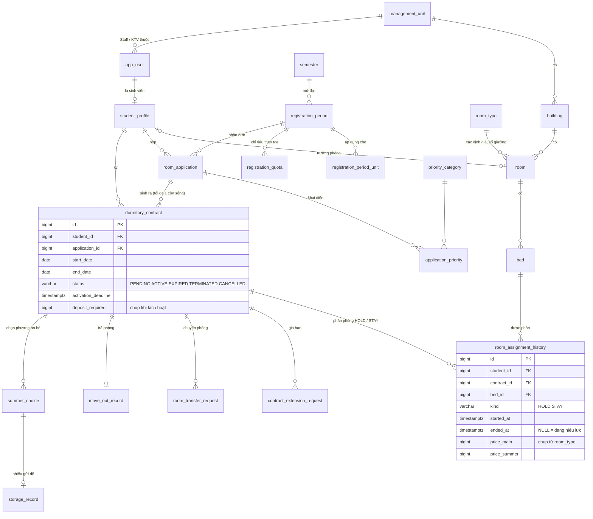
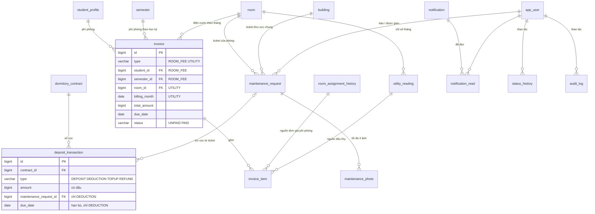

# Thiết kế cơ sở dữ liệu — DMS

> **Phiên bản 0.8**, 15/10/2026, Nhóm 3 — Chuyên đề CNTT, 65CNTT
> Căn cứ: `SRS-DMS.md` v0.11 (mục 4, 5, 10), `he-thong-quan-ly-ky-tuc-xa-mini.md`, `DMS-UI-UX-Design.md`
> DDL bảng nghiệp vụ hiện tại: [`DB-DMS-schema.sql`](DB-DMS-schema.sql), gồm `security_version`, danh tính Keycloak, ma trận quyền động V5 và quyền V6; kết quả kiểm chứng các bản trước ở mục 9. Bảng Spring Session có migration riêng V2.
> Trạng thái: **đã chốt Q-DB-01..10** theo thẩm định của nhóm (mục 8). Ghi chú cho tầng JPA ở mục 10.

### Lịch sử thay đổi

| Phiên bản | Ngày | Nội dung |
|---|---|---|
| 0.1 | 10/10/2026 | Bản đầu tiên: ERD, DDL PostgreSQL 16, partial unique index, ánh xạ lỗi, JPA notes |
| 0.2 | 10/10/2026 | Chốt Q-DB-01..10, bổ sung sequence và fn_next_code |
| 0.3 | 13/10/2026 | Bổ sung V2 bảng Spring Session |
| 0.4 | 13/10/2026 | Bổ sung V3 security_version và ràng buộc không âm |
| 0.5 | 14/10/2026 | Bổ sung V4 Keycloak OIDC, keycloak_user_id nullable password_hash |
| 0.6 | 15/10/2026 | Bổ sung V5 ma trận quyền động role_permission_matrix (STAFF=72, STUDENT=35, TECHNICIAN=11, ADMIN=105) |
| 0.7 | 15/10/2026 | Ánh xạ ràng buộc CSDL theo code review, chặn sửa bed_count loại phòng đang dùng và hủy đơn đã có hợp đồng |
| 0.8 | 15/10/2026 | Bổ sung Flyway V6 cấp quyền ROOM_TRANSFER_APPROVE cho STAFF (STAFF=73, ADMIN=106); ghi chú JPA/Service: status_history entity_type='TRANSFER', lịch sử trưởng phòng từ audit_log (ROOM_LEADER_CHANGE), missingLeader tính động khi đọc |

---

### Bổ sung Keycloak v0.5 — 14/10/2026

Flyway V4 thêm `app_user.keycloak_user_id VARCHAR(255)` với unique index từng subject không null và cho phép `password_hash` null. Subject bất biến liên kết danh tính; username không làm khóa ghép tự động. Tài khoản Keycloak không lưu hash local; mật khẩu và SSO nằm trong database Keycloak riêng. ID hồ sơ DMS và khóa ngoại nghiệp vụ giữ nguyên.

Version DMS tiếp tục tăng khi khóa/reset/thay đổi quyền/logout tại DMS và được đưa vào JWT qua mapper từ thuộc tính chỉ Admin được sửa. Principal JWT không ghi Spring Session. Các mô tả BCrypt/session v0.4 bên dưới thuộc chế độ legacy-session; không áp dụng đăng nhập mặc định. V1–V3 giữ nguyên.

DB và Keycloak không có transaction phân tán; rollback dùng thao tác bù, xóa danh tính sau commit. Mất kết nối lúc bù cần đối soát. Không thay thế migration bằng chạy lại snapshot SQL.

## 1. Phạm vi và quy ước

| Hạng mục | Lựa chọn | Ghi chú |
|---|---|---|
| DBMS | **PostgreSQL 16** | Theo SRS mục 2.5. Cần partial unique index, `EXCLUDE`, `JSONB`, generated column |
| Migration | Flyway V1 tạo nghiệp vụ, V2 Spring Session, V3 `security_version`, V4 Keycloak, V5 ma trận quyền, V6 cấp `ROOM_TRANSFER_APPROVE` cho STAFF | Giữ nguyên V1–V4; snapshot SQL hiện tại không dùng để nâng cấp CSDL đã chạy. Hibernate `ddl-auto: validate` |
| Đặt tên | `snake_case`, số ít (`room`, `bed`) | `app_user` thay cho `user` vì `user` là từ khóa |
| Khóa chính | `BIGINT GENERATED ALWAYS AS IDENTITY` | Mã hiển thị (HD-2026-0012, TK-1024) là cột `code` riêng, `UNIQUE` |
| Mã hiển thị | Sequence riêng mỗi loại + hàm `fn_next_code` | Xem Q-DB-10 |
| Tiền | `BIGINT`, đơn vị đồng | VND không có phần lẻ; tránh sai số dấu phẩy động |
| Thời gian | `TIMESTAMPTZ` cho thời điểm, `DATE` cho ngày | Múi giờ ứng dụng: Asia/Ho_Chi_Minh |
| Giá trị liệt kê | `VARCHAR` + `CHECK` | Map thẳng với `@Enumerated(EnumType.STRING)` của JPA (xem Q-DB-02) |
| Dữ liệu suy ra | Không lưu, chỉ tính trong view | BR-08: số chỗ trống, số dư cọc, nhãn quá hạn… |
| Xóa dữ liệu | Không xóa cứng dữ liệu đã phát sinh nghiệp vụ | Dùng trạng thái: `CLOSED`, `RETIRED`, `locked` |
| Phiên đăng nhập | Spring Session JDBC, bảng `spring_session` và `spring_session_attributes` tạo qua Flyway V2 | Không vẽ trong ERD; Spring không tự tạo lại schema phiên khi khởi động |

**Quy mô ước tính** (~1.500 sinh viên, 1 năm): `room_assignment_history` vài nghìn dòng, `invoice` ~5.000 (3 học kỳ phí phòng + 12 tháng điện nước × ~300 phòng), `notification` vài chục nghìn. Index ở mục 6 là đủ, không cần partition.

---

## 2. Sơ đồ ERD

Sơ đồ viết bằng Mermaid, xem được trong VS Code (extension Markdown Preview Mermaid), GitHub hoặc mermaid.live. Bản ảnh đã render: [`DB-ERD-1.png`](DB-ERD-1.png), [`DB-ERD-2.png`](DB-ERD-2.png). Chỉ ghi khóa và vài cột chính; cột đầy đủ ở file DDL. `utility_rate` không có khóa ngoại tới hóa đơn: đơn giá được chụp vào `invoice_item.unit_price` lúc phát hành.

### 2.1. Tổ chức, phòng, đăng ký, hợp đồng



### 2.2. Tài chính, sửa chữa, thông báo



---

## 3. Danh sách bảng

### 3.1. Tổ chức, tài khoản

| Bảng | Mục đích | Ràng buộc chính | Truy vết |
|---|---|---|---|
| `management_unit` | Đơn vị quản lý: K1; N2 + N3 | `code` duy nhất | BR-07 |
| `app_user` | Tài khoản mọi vai trò | Staff, KTV bắt buộc có đơn vị; Student, Admin không có. `cross_unit_access` chỉ cho Staff; `security_version >= 0` | FR-ACC-01..08 |
| `student_profile` | Hồ sơ sinh viên, 1-1 với `app_user` | Mọi bảng nghiệp vụ tham chiếu sinh viên qua đây (Q-DB-03) | FR-ACC-04, 05 |
| `system_config` | Tham số cấu hình: 7 ngày kích hoạt, 15 ngày sắp hết hạn, 3 ngày tự đóng… | Khóa dạng `contract.activation_days` | SRS 2.6 |

**Phiên bản bảo mật tài khoản (bản 0.4):** `app_user.security_version` có kiểu `BIGINT NOT NULL DEFAULT 0`, ràng buộc `ck_user_security_version CHECK (security_version >= 0)`. Flyway V3 bổ sung cột vào CSDL hiện có; snapshot SQL đưa cột trực tiếp vào `CREATE TABLE app_user`. Đây là số tăng khi thu hồi phiên, không phải cột khóa lạc quan `@Version`.

Principal của phiên lưu ID tài khoản, vai trò và version lúc đăng nhập; `getName()` trả ID dạng chuỗi để lập `spring_session.principal_name`. Đổi/reset mật khẩu, khóa tài khoản hoặc đổi username/đơn vị/quyền liên đơn vị khóa hàng tài khoản, tăng version và lưu cùng transaction. Sau commit, dịch vụ dọn các session cũ theo ID, giữ các phiên đăng nhập mới có version hợp lệ. Request cũ lưu lại session hoặc việc dọn vật lý bị lỗi vẫn không qua được kiểm tra version trên request tiếp theo. Mở khóa không giảm version.

Mật khẩu chỉ lưu hash BCrypt; mật khẩu tạm trả một lần, không ghi audit dạng rõ. Đổi mật khẩu yêu cầu đăng nhập lại; reset đặt `must_change_password = TRUE`, xóa `failed_login_count`/`locked_until` nhưng không tự mở khóa do Admin. Tài khoản bootstrap phải được bật cấu hình và cung cấp mật khẩu riêng; không có dữ liệu demo được tự nạp trong profile dev.

### 3.2. Phòng, giường, học kỳ

| Bảng | Mục đích | Ràng buộc chính | Truy vết |
|---|---|---|---|
| `building` | Tòa, thuộc một đơn vị, có **mức cọc** | `deposit_amount > 0` | FR-ROOM-01 |
| `room_type` | Số giường, **giá gốc HK chính và hè** | Nơi duy nhất lưu giá gốc. Ràng buộc nghiệp vụ: không cho phép cập nhật `bed_count` khi loại phòng đã được gán cho ít nhất một phòng đang tồn tại (trả 409 `RESOURCE_IN_USE`) nhằm bảo toàn số giường vật lý và công suất | FR-ROOM-02 |
| `room` | Phòng; trạng thái vận hành; **trưởng phòng** | `UNIQUE(building_id, code)`; một sinh viên làm trưởng tối đa một phòng | FR-ROOM-03, 05, 09 |
| `bed` | Giường; `ACTIVE` / `BROKEN` / `RETIRED` | `RETIRED` thay cho xóa khi bớt giường (FR-ROOM-04, 06) | FR-ROOM-04..06 |
| `semester` | HK1, HK2, Hè | `UNIQUE(academic_year, type)`; **không chồng thời gian** (`EXCLUDE`) | FR-ROOM-11 |

### 3.3. Đăng ký

| Bảng | Mục đích | Ràng buộc chính | Truy vết |
|---|---|---|---|
| `registration_period` | Đợt đăng ký; `kind = REGULAR` hoặc `SUMMER` (đợt chọn phương án hè) | `close_at > open_at` | FR-REG-01, 13 |
| `registration_period_unit` | Đợt áp dụng cho đơn vị nào | PK kép | FR-REG-01 |
| `registration_quota` | Chỉ tiêu theo tòa | PK kép | FR-REG-01 |
| `priority_category` | Diện ưu tiên + trọng số cấu hình được | | Q-07, FR-REG-05 |
| `room_application` | Đơn đăng ký | `UNIQUE(student_id, period_id)`; REJECTED bắt buộc lý do. Đơn APPROVED chỉ được phép hủy khi chưa sinh hợp đồng PENDING hoặc ACTIVE liên kết (trả 409 `APPLICATION_HAS_CONTRACT`) | FR-REG-02..12 |
| `application_priority` | Diện sinh viên khai và kết quả Staff xác nhận | `verified` NULL / TRUE / FALSE | FR-REG-06 |

### 3.4. Hợp đồng, phân phòng, kỳ hè

| Bảng | Mục đích | Ràng buộc chính | Truy vết |
|---|---|---|---|
| `dormitory_contract` | Hợp đồng; **không** lưu phòng, giá, số dư cọc | Mỗi sinh viên ≤ 1 hợp đồng PENDING / ACTIVE; mỗi đơn ≤ 1 hợp đồng còn sống; ACTIVE bắt buộc có `activated_at`, `deposit_required` | FR-CON-01..06, BR-02 |
| `room_assignment_history` | **Nguồn duy nhất** cho "ai ở giường nào, từ bao giờ, giá bao nhiêu" | 2 partial unique index (mục 4); khóa ngoại kép `(contract_id, student_id)` | BR-01, BR-02, FR-CON-08 |
| `contract_extension_request` | Yêu cầu gia hạn; `source = SUMMER_STAY` khi ở hè | ≤ 1 yêu cầu PENDING mỗi hợp đồng | FR-CON-06, FR-REG-15 |
| `room_transfer_request` | Yêu cầu chuyển phòng | ≤ 1 PENDING mỗi hợp đồng; APPROVED phải có giường đích | FR-CON-07 |
| `move_out_record` | Biên bản trả phòng | 1-1 với hợp đồng; `refund_amount = max(số dư, 0)` | FR-CON-09, BR-10 |
| `summer_choice` | Phương án hè: ở hè / tạm rời / rời KTX | `UNIQUE(contract_id, semester_id)` | FR-REG-14 |
| `storage_record` | Phiếu gửi đồ; lưu **giường cũ** để gợi ý phân lại | ≤ 1 phiếu chưa nhận lại mỗi hợp đồng | FR-CON-11, 12 |

### 3.5. Tài chính

| Bảng | Mục đích | Ràng buộc chính | Truy vết |
|---|---|---|---|
| `deposit_transaction` | Sổ cọc: thu / trừ / bù / hoàn | Dấu số tiền theo loại; thu cọc 1 lần, hoàn cọc 1 lần; mỗi ticket trừ 1 lần mỗi hợp đồng; DEDUCTION bắt buộc có ticket và hạn bù | FR-BIL-09, BR-10 |
| `utility_rate` | Đơn giá điện, nước có ngày hiệu lực | `UNIQUE(meter_type, effective_from)` | FR-BIL-01 |
| `utility_reading` | Chỉ số tháng theo phòng; có cột thay đồng hồ; `consumption` là cột tính | `UNIQUE(room_id, meter_type, billing_month)`; cuối ≥ đầu | FR-BIL-02, 03, BR-03 |
| `invoice` | Hai loại: `ROOM_FEE` (sinh viên, học kỳ), `UTILITY` (phòng, tháng) | CHECK đúng bộ cột theo loại; 2 partial unique index; PAID phải đủ người xác nhận, thời gian, hình thức | FR-BIL-04..08, BR-04 |
| `invoice_item` | Dòng hóa đơn; đơn giá chụp lúc phát hành | Dòng phí phòng trỏ về phân phòng; dòng điện nước trỏ về chỉ số; dòng điều chỉnh bắt buộc lý do | FR-BIL-04, 05, 12 |

### 3.6. Sửa chữa, thông báo, lịch sử

| Bảng | Mục đích | Ràng buộc chính | Truy vết |
|---|---|---|---|
| `maintenance_request` | Ticket của phòng **hoặc** khu vực chung (tòa + tầng) | Đúng một loại vị trí; ASSIGNED trở đi phải có KTV; `cause` chỉ ở ticket phòng đã CLOSED; MISUSE phải có chi phí > 0; WEAR không có chi phí, bắt buộc ghi chú | FR-MNT-01..10 |
| `maintenance_photo` | Ảnh sự cố | Giới hạn 3 ảnh kiểm tra ở Service | FR-MNT-01 |
| `notification` | Thông báo theo phạm vi ALL / UNIT / BUILDING / FLOOR / ROOM / USER | CHECK đúng cột theo phạm vi | FR-NOT-01..04 |
| `notification_read` | Trạng thái đã đọc theo người | PK kép | FR-NOT-03 |
| *(view)* `v_user_notification` | Hộp thư thông báo của từng người, theo thời gian ở thực tế | Xem mục 5 và Q-DB-08 | FR-NOT-03 |
| `status_history` | Lịch sử chuyển trạng thái dùng chung; dữ liệu cho timeline | Index `(entity_type, entity_id, created_at)` | BR-09, FR-MNT-08 |
| `audit_log` | Nhật ký thao tác quản trị và tác vụ tự động | **Chỉ ghi thêm** (trigger chặn UPDATE / DELETE) | FR-ACC-09, NFR-REL-03 |

---

## 4. Bất biến do CSDL bảo vệ

Đây là lớp phòng thủ thứ hai sau Service. Service vẫn kiểm tra trước để trả lỗi tiếng Việt có `errorCode`; CSDL đảm bảo không có dữ liệu sai kể cả khi có lỗi lập trình hay request đồng thời.

| Quy tắc | Cơ chế trong DDL | Tên ràng buộc → `errorCode` gợi ý |
|---|---|---|
| BR-01 Một giường ≤ 1 phân phòng hiệu lực | `UNIQUE(bed_id) WHERE ended_at IS NULL` | `ux_assignment_open_bed` → `BED_TAKEN` |
| BR-02 Một sinh viên ≤ 1 phân phòng hiệu lực | `UNIQUE(student_id) WHERE ended_at IS NULL` | `ux_assignment_open_student` → `STUDENT_ALREADY_ASSIGNED` |
| BR-02 Một sinh viên ≤ 1 hợp đồng PENDING / ACTIVE | `UNIQUE(student_id) WHERE status IN (…)` | `ux_contract_live_student` → `CONTRACT_EXISTS` |
| Phân phòng khớp hợp đồng | FK kép `(contract_id, student_id)` → `dormitory_contract(id, student_id)` | |
| Một đơn mỗi đợt | `UNIQUE(student_id, period_id)` | → `APPLICATION_EXISTS` |
| BR-03 Chỉ số điện nước | `UNIQUE(room_id, meter_type, billing_month)`, CHECK cuối ≥ đầu (kể cả khi thay đồng hồ) | → `READING_INVALID` |
| FR-BIL-12 Tổng hóa đơn không âm (kể cả sau dòng điều chỉnh âm) | `CHECK (total_amount >= 0)` trên `invoice` | → `ADJUSTMENT_INVALID` |
| BR-04 Không phát hành trùng | `UNIQUE(student_id, semester_id) WHERE type='ROOM_FEE'`, `UNIQUE(room_id, billing_month) WHERE type='UTILITY'` | → `DUPLICATE_INVOICE` |
| BR-10 Sổ cọc | CHECK dấu theo loại; `UNIQUE(contract_id) WHERE type='DEPOSIT'` và `='REFUND'`; `UNIQUE(contract_id, maintenance_request_id) WHERE type='DEDUCTION'` | → `DEPOSIT_INVALID` |
| BR-10 Hoàn cọc bằng số dư | `move_out_record`: `refund_amount = GREATEST(deposit_balance, 0)` | |
| FR-MNT-09 Nguyên nhân, chi phí | 4 CHECK trên `maintenance_request` | → `COST_INVALID` |
| Học kỳ không chồng nhau | `EXCLUDE USING gist (daterange(...) WITH &&)` | `semester_daterange_excl` → `SEMESTER_OVERLAP` |
| Một trưởng phòng một phòng | `UNIQUE(leader_student_id) WHERE leader_student_id IS NOT NULL` | `ux_room_leader` → `LEADER_ALREADY_ASSIGNED` |
| Mã sinh viên duy nhất; mã giường duy nhất trong phòng | `UNIQUE(student_code)`, `UNIQUE(room_id, code)` | → `STUDENT_CODE_EXISTS`, `BED_CODE_EXISTS` |
| Ràng buộc còn lại | | UNIQUE / EXCLUDE → `DUPLICATE_VALUE`; khóa ngoại → `RESOURCE_IN_USE`; NOT NULL / CHECK → `VALIDATION_FAILED`; còn lại `CONCURRENT_UPDATE` |
| Nhật ký chỉ ghi thêm | Trigger `tg_audit_log_append_only` | |

### Service vẫn phải kiểm tra (CSDL không diễn đạt gọn được)

- **Khóa và kiểm tra lại**: `SELECT … FOR UPDATE` trên giường và sinh viên trước khi phân phòng; chuyển phòng khóa hai giường theo `bed_id` tăng dần (BR-05).
- Giới tính sinh viên khớp giới tính phòng; phòng `ACTIVE`, giường `ACTIVE` (BR-01).
- Giường đích chuyển phòng **cùng đơn vị** (BR-05); Staff, KTV chỉ thao tác trong đơn vị mình (BR-07).
- Trưởng phòng đang có phân phòng `STAY` trong chính phòng đó; gỡ khi phân phòng đóng (BR-11).
- Chuyển trạng thái đúng bảng ở SRS mục 10 (CSDL chỉ kiểm tra giá trị hợp lệ, không kiểm tra từ → sang).
- `summer_choice.semester_id` là học kỳ hè; ≤ 3 ảnh mỗi ticket.
- `invoice.total_amount` = tổng `invoice_item.amount`: aggregate `Invoice` tạo hóa đơn và các dòng, tính tổng trong **cùng một transaction** (mục 10).
- Hợp đồng ACTIVE luôn có phân phòng `STAY` trừ khi có phiếu gửi đồ mở (BR-02).
- **Bảo toàn số giường loại phòng (`room_type`)**: Khi cập nhật `room_type`, nếu `bed_count` thay đổi so với giá trị hiện tại, Service phải kiểm tra xem loại phòng đã được gán cho phòng nào trong bảng `room` chưa (`rooms.exists(roomTypeId == entity.id)`). Nếu loại phòng đang được sử dụng bởi ít nhất một phòng đang tồn tại, từ chối cập nhật và trả 409 `RESOURCE_IN_USE` nhằm bảo toàn số giường vật lý và công suất phòng.
- **Hủy đơn APPROVED tránh hợp đồng mồ côi**: Khi sinh viên hủy đơn `APPROVED`, Service phải kiểm tra xem đơn đã sinh hợp đồng `PENDING` hoặc `ACTIVE` liên kết chưa (`ContractService.hasLiveContractForApplication(applicationId)`). Nếu có, chặn 409 `APPLICATION_HAS_CONTRACT` và ẩn thao tác `cancel` trong `allowedActions` nhằm bảo toàn tính toàn vẹn và tránh hợp đồng mồ côi; người dùng phải thực hiện thủ tục hủy giữ chỗ / hợp đồng trước.

---

## 5. View hỗ trợ (SRS mục 5.2)

| View | Trả về | Dùng ở |
|---|---|---|
| `v_current_stay` | Hợp đồng PENDING / ACTIVE + phân phòng hiệu lực + giường, phòng, tòa, đơn vị, đơn giá | Phòng của tôi; lọc phạm vi BR-07; phát hành phí phòng |
| `v_room_occupancy` | Theo phòng: giường hoạt động / đang giữ / đang ở / trống, trưởng phòng | Card phòng, gợi ý giường (UC-16), dashboard |
| `v_deposit_balance` | Mức cọc, số dư, **số cần bù** (chỉ khi ACTIVE), hạn bù cũ nhất chưa bù, cờ **quá hạn bù cọc**, **nợ cọc** sau trả phòng | Sổ cọc, danh sách cần nhắc, công nợ |
| `v_summer_leave` | Sinh viên đang tạm rời hè, phiếu gửi đồ, giường cũ còn trống không | Màn phân lại giường đầu HK1 |
| `v_contract_label` | Hợp đồng ACTIVE + số ngày còn lại + nhãn Sắp hết hạn / Quá hạn trả phòng / Tạm rời hè | Badge, dashboard |
| `v_user_notification` | Mỗi dòng là một (người dùng, thông báo) người đó được xem, kèm `read_at`, `is_read`. Luôn lọc `WHERE user_id = ?` | Hộp thư thông báo, số chưa đọc (FR-NOT-03) |

**Cách tính "quá hạn bù cọc"** trong `v_deposit_balance`: các lần bù được trả cho các lần trừ theo thứ tự thời gian. Lần trừ thứ *i* coi là đã bù xong khi tổng trừ lũy kế đến *i* ≤ tổng đã bù. Hạn bù của lần trừ đầu tiên chưa bù xong là `oldest_unpaid_due`; quá hạn khi ngày đó < hôm nay. Ví dụ đã chạy thử: bị trừ 50.000 đ, bù 25.000 đ → cần bù 25.000 đ, quá hạn.

**Ai thấy thông báo nào** trong `v_user_notification` (Q-DB-08):

| Người dùng | Thấy |
|---|---|
| Mọi người | `ALL`; `USER` gửi đích danh |
| Sinh viên | `ROOM`, `FLOOR`, `BUILDING`, `UNIT` được đăng trong lúc mình **thật sự ở** (phân phòng `STAY`) tại phòng / tầng / tòa / đơn vị đó, khoảng `[stay_started_at, ended_at)`. Giữ chỗ (`HOLD`) chưa tính. Sau khi chuyển phòng hay trả phòng vẫn xem lại được thông báo của lần ở cũ, nhưng không thấy thông báo đăng sau khi rời |
| Staff, KTV | Thêm `UNIT`, `BUILDING`, `FLOOR` thuộc đơn vị mình. Thông báo `ROOM` dành cho người ở; Staff xem ở màn quản lý thông báo (đọc thẳng bảng `notification`) |
| Admin | Chỉ `ALL`, `USER` |

---

## 6. Truy vấn mẫu cho các nghiệp vụ khó

**Chia trừ cọc cho sinh viên đang ở lúc tạo ticket** (FR-MNT-10, UC-22). Lịch sử phân phòng cho phép tính đúng kể cả khi có người đã chuyển đi trước lúc đóng ticket:

```sql
SELECT a.contract_id, a.student_id
FROM maintenance_request m
JOIN bed b ON b.room_id = m.room_id
JOIN room_assignment_history a ON a.bed_id = b.id
WHERE m.id = :ticketId
  AND a.kind = 'STAY'
  AND a.started_at <= m.created_at
  AND (a.ended_at IS NULL OR a.ended_at > m.created_at)
ORDER BY a.student_id;   -- người cuối nhận phần lẻ
```

**Tác vụ tự hủy hợp đồng PENDING quá hạn** (FR-CON-02, chạy mỗi giờ, idempotent):

```sql
SELECT id FROM dormitory_contract
WHERE status = 'PENDING' AND activation_deadline < now()
FOR UPDATE SKIP LOCKED;
-- với mỗi id, trong một transaction: hợp đồng → CANCELLED, đóng phân phòng (HOLD_EXPIRED),
-- đơn → CANCELLED, ghi status_history và audit_log với actor = SYSTEM
```

**Danh sách phát hành phí phòng một học kỳ** (UC-21), bỏ qua người đã có hóa đơn:

```sql
SELECT s.student_id, s.assignment_id,
       CASE WHEN sem.type = 'SUMMER' THEN s.price_summer ELSE s.price_main END AS amount
FROM v_current_stay s
JOIN semester sem ON sem.id = :semesterId
WHERE s.contract_status = 'ACTIVE' AND s.assignment_kind = 'STAY'
  AND s.management_unit_id = :unitId
  AND NOT EXISTS (SELECT 1 FROM invoice i
                  WHERE i.type = 'ROOM_FEE' AND i.student_id = s.student_id AND i.semester_id = sem.id);
-- học kỳ hè: thêm điều kiện có summer_choice STAY đã APPROVED
```

**Index chính** ngoài các khóa: đơn theo `(period_id, preferred_unit_id, status, priority_score DESC)`; hợp đồng PENDING theo `activation_deadline`; ticket theo `(assigned_to, status)`; hóa đơn UNPAID theo `due_date`; `status_history` và `audit_log` theo đối tượng.

---

## 7. Khác biệt so với SRS mục 5.1

Các thay đổi này đã được đưa vào SRS mục 5.1 (SRS v0.5).

Bản 0.4 đồng bộ thêm `security_version` vào SRS v0.7 và migration V3; cấu trúc nghiệp vụ trước đó không đổi.

| Thay đổi | Lý do |
|---|---|
| Tách `User` thành `app_user` + `student_profile` | Khóa ngoại tới `student_profile` đảm bảo `student_id` luôn là sinh viên; bảng tài khoản gọn hơn |
| Thêm `app_user.security_version` | Thu hồi phiên khi mật khẩu/quyền thay đổi, kể cả session cũ được request đang chạy lưu lại |
| Thêm `priority_category`, `application_priority` | SRS nói "trọng số cấu hình được" và "Staff xác nhận từng diện" nhưng chưa có bảng |
| Thêm `registration_period_unit`, `registration_period.kind` | Đợt áp dụng cho một hoặc hai đơn vị; đợt hè khác đợt thường |
| `MaintenanceStatusHistory` → `status_history` dùng chung | Đơn, hợp đồng, yêu cầu cũng cần timeline (UI mục 8, 11, 21) |
| Thêm `maintenance_photo`, `system_config` | Ảnh sự cố (FR-MNT-01); tham số cấu hình (SRS 2.6) |
| `dormitory_contract.activation_deadline` | Chụp hạn khi phân giường, đổi cấu hình không ảnh hưởng hợp đồng đang chờ |
| `room_assignment_history.stay_started_at`, `end_reason` | Ghi lúc HOLD → STAY trên cùng dòng; biết vì sao phân phòng đóng |
| `storage_record.previous_bed_id` | Gợi ý giường cũ khi phân lại đầu HK1 (FR-CON-12) |
| `contract_extension_request.source` | Ở hè "ghi như một gia hạn" (FR-REG-15) |
| `utility_reading`: cột thay đồng hồ + `consumption` tính sẵn | FR-BIL-03 không cần bảng riêng |
| `bed.status` thêm `RETIRED` | Bớt giường mà không xóa (FR-ROOM-04, 06) |
| `notification`: cột FK riêng theo phạm vi thay cho `target_id` | Có khóa ngoại thật, CHECK đúng cột theo phạm vi |

---

## 8. Các quyết định đã chốt

Bản 0.1 để mở 10 câu hỏi. Nhóm thẩm định và chốt ngày 10/10/2026:

| Mã | Câu hỏi | Quyết định | Ghi chú |
|---|---|---|---|
| **Q-DB-01** | Tiền lưu kiểu gì? | `BIGINT` (đồng) | Chỉ số đồng hồ và `consumption` là `INT`; chỉ `invoice_item.quantity` là `NUMERIC(10,2)` |
| **Q-DB-02** | `ENUM` của PostgreSQL hay `VARCHAR + CHECK`? | `VARCHAR + CHECK` | Map `@Enumerated(EnumType.STRING)`, thêm giá trị chỉ cần sửa CHECK |
| **Q-DB-03** | Tách `student_profile` khỏi `app_user`? | Tách | JPA: `@OneToOne @MapsId` (mục 10) |
| **Q-DB-04** | Lịch sử trạng thái chung hay riêng? | Một bảng `status_history` chung | Một component timeline dùng cho mọi đối tượng |
| **Q-DB-05** | Lịch sử trưởng phòng lưu ở đâu? | Cột `room.leader_student_id`, lịch sử trong `audit_log` | Người thực nộp hóa đơn điện nước ghi ở `invoice.payer_user_id` / `payer_name` **lúc xác nhận thanh toán** |
| **Q-DB-06** | Hủy giữ chỗ để phân lại: hợp đồng mới hay cũ? | Hợp đồng mới; hợp đồng cũ CANCELLED | Một đơn ≤ 1 hợp đồng còn sống (`ux_contract_live_application`) |
| **Q-DB-07** | Chặn hợp đồng chồng thời gian bằng CSDL? | Chỉ kiểm tra ở Service (FR-CON-06) | `EXCLUDE` vướng hợp đồng TERMINATED sớm |
| **Q-DB-08** | Ai được xem thông báo theo phạm vi? | Tính khi truy vấn, theo **khoảng thời gian ở thực tế**: view `v_user_notification` (mục 5) | Không fan-out danh sách người nhận |
| **Q-DB-09** | Diện ưu tiên, trọng số khởi tạo | Chính sách 50, năm nhất 30, ở xa 20 | Có trong dữ liệu khởi tạo |
| **Q-DB-10** | Mã hiển thị sinh thế nào? | Sequence `seq_contract_code`, `seq_maintenance_code` (từ 1000), `seq_invoice_code` + hàm `fn_next_code(prefix, seq, with_year)` | Xem bên dưới |

**Định dạng mã** (Q-DB-10):

| Đối tượng | Mã | Lời gọi trong Service |
|---|---|---|
| Hợp đồng | `HD-2026-0012` | `SELECT fn_next_code('HD', 'seq_contract_code', TRUE)` |
| Ticket sửa chữa | `TK-1024` | `SELECT fn_next_code('TK', 'seq_maintenance_code', FALSE)` |
| Hóa đơn phí phòng / điện nước | `HP-2026-0001` / `DN-2026-0002` (chung một dãy số) | `SELECT fn_next_code('HP', 'seq_invoice_code', TRUE)` |

- Số được đệm tối thiểu 4 chữ số và tự dài ra khi vượt 9999 (`DN-2026-10000`). Không dùng `lpad(v, 4, '0')` vì PostgreSQL cắt chuỗi dài hơn (12345 thành `1234`, gây trùng mã), cũng không dùng `to_char(v, 'FM0000')` vì tràn thành `####`.
- Sequence không reset theo năm: số chạy liên tục, năm trong mã chỉ để dễ đọc. Năm lấy theo giờ Việt Nam, không phụ thuộc `TimeZone` của phiên.
- Sequence không bị khóa theo transaction nên không có race condition; rollback làm hụt số, chấp nhận được.

---

## 9. Kiểm thử đã chạy

DDL bản 0.2 được nạp vào PostgreSQL 16.15 sạch: **33 bảng, 6 view, 3 sequence**, không lỗi. Sau đó chạy một kịch bản dữ liệu mẫu (2 phòng, 5 sinh viên, đi qua phân giường → kích hoạt → báo hỏng → trừ cọc → bù cọc → trả phòng → tạm rời hè → điện nước → hóa đơn). Kịch bản cố ý vi phạm **28 ràng buộc** và CSDL từ chối cả 28, trong đó:

- Phân hai người vào một giường; tạo hợp đồng sống thứ hai cho cùng sinh viên; phân phòng lệch sinh viên của hợp đồng.
- Kích hoạt khi chưa có cọc; thu cọc hai lần; hoàn cọc hai lần; hoàn sai số dư; bù cọc số âm.
- Kết luận chi phí khi ticket chưa đóng; hao mòn có chi phí; hư hỏng chi phí 0; trừ cọc hai lần cùng ticket.
- Chỉ số cuối < đầu; trùng kỳ; kỳ không phải ngày 1; phát hành trùng phí phòng và điện nước; hóa đơn lẫn cột hai loại; PAID thiếu thông tin.
- Học kỳ chồng nhau; sửa hoặc xóa `audit_log`.

Kết quả đúng ở các view:

- **AT-14**: ticket phòng có 4 người đang ở → truy vấn mục 6 trả 4 người.
- **AT-19**: bị trừ 50.000 đ, chưa bù, trả phòng → hoàn 950.000 đ, sau trả phòng `topup_needed = 0`, `deposit_debt = 0`.
- Thay đồng hồ giữa kỳ: đầu 980, đồng hồ cũ chốt 1.000, đồng hồ mới 0 → 40 ⇒ tiêu thụ 60.

Kiểm thử thêm ở bản 0.2:

- **Sinh mã**: `HD-2026-0001`, `TK-1000`, `HP-2026-0001`; sau 9999 ra `DN-2026-10000`, sau 999999 ra `DN-2026-1000000` (vẫn vừa `VARCHAR(20)`); phiên đặt `TimeZone = UTC` vẫn ra năm theo giờ Việt Nam.
- **Thông báo**: sinh viên đang ở A101 thấy thông báo của phòng, tầng, đơn vị đăng sau khi vào ở, không thấy thông báo phòng đăng trước đó; sinh viên đã rời A101 vẫn thấy thông báo đăng trong lần ở cũ, không thấy thông báo đăng sau khi rời; sinh viên chưa ở đâu chỉ thấy `ALL`; Staff, KTV thấy thông báo đơn vị và tầng của đơn vị mình; không có dòng trùng. Truy vấn theo một người dùng đi qua index `ix_assignment_student`.

Bản 0.3 (theo thẩm định Đặc tả API): thêm `CHECK (total_amount >= 0)` cho `invoice`; nạp lại DDL vào PostgreSQL 16 sạch: 33 bảng, 6 view, không lỗi, ràng buộc có trong `pg_constraint`.

Bản 0.4 ngày 13/10/2026: bổ sung `security_version` và ràng buộc không âm trong migration V3 và snapshot. Kiểm chứng cần bao gồm migration từ V1/V2, đăng nhập nhiều phiên, đổi/reset/khóa tài khoản và request cũ lưu lại session; số lượng bảng/view nghiệp vụ giữ nguyên. Kết quả test ứng dụng được ghi riêng trong README backend sau khi chạy bộ kiểm thử.

Kịch bản kiểm thử chưa đưa vào thư mục Database Design; có thể chuyển thành test tích hợp (Testcontainers) khi bắt đầu code.

---

## 10. Ghi chú cho tầng Spring Boot / JPA

| Chỗ | Cách làm |
|---|---|
| `room_assignment_history` → hợp đồng, sinh viên (FK kép) | Hợp đồng và sinh viên thuộc module khác (`contract`, `account`), nên theo SAD mục 4.2 chỉ map cột ID: `Long contractId`, `Long studentId`. Không cần `@JoinColumns`. FK kép dưới CSDL vẫn chặn trường hợp lệch nhau; Service bắt lỗi để trả `errorCode` |
| Quan hệ chéo module nói chung | Chỉ lưu ID (SAD mục 4.2, AD-10); `@ManyToOne` chỉ dùng giữa các bảng cùng module |
| `student_profile` | `@OneToOne @MapsId` tới `AppUser`, khóa chính chính là `user_id` |
| `utility_reading.consumption` (cột sinh tự động) | `@Generated` (Hibernate 6) và `@Column(insertable = false, updatable = false)` |
| Giá trị liệt kê | `@Enumerated(EnumType.STRING)`; tên hằng Java trùng giá trị trong CHECK |
| Mã hiển thị | Gọi `fn_next_code` trong Service lúc tạo (repository native query), không dùng `@GeneratedValue` cho cột `code` |
| `Invoice` | Aggregate root: tạo hóa đơn cùng các `InvoiceItem` (`cascade = ALL`), tính `totalAmount` = tổng dòng rồi lưu trong **một** `@Transactional`. Sau khi đã thanh toán thì không sửa hóa đơn; điều chỉnh bằng dòng `ADJUSTMENT` ở hóa đơn kỳ sau (`adjusts_invoice_id`, FR-BIL-12) |
| View (`v_current_stay`, `v_user_notification`…) | Entity chỉ đọc `@Immutable` + `@Subselect` / `@Table(name = "v_…")`, hoặc projection qua native query |
| Ràng buộc → `errorCode` | Bắt `DataIntegrityViolationException`, đọc tên ràng buộc (mục 4) để trả mã lỗi tiếng Việt |
| `status_history` cho chuyển phòng | Dùng `entity_type = 'TRANSFER'`, `entity_id` là `room_transfer_request.id` cho các thao tác `APPROVE`, `REJECT`, `CANCEL` |
| Lịch sử trưởng phòng | Không tạo bảng riêng; đọc từ `audit_log` (`action = 'ROOM_LEADER_CHANGE'`, `entity_type = 'ROOM'`, `old_value`/`new_value` là ID sinh viên dạng JSON number). `actor_id = null` là trường hợp hệ thống tự gỡ khi sinh viên kết thúc phân phòng đang ở (FR-ROOM-10) |
| Cảnh báo thiếu trưởng phòng | Cờ `missingLeader` được tính động khi đọc (`status = 'ACTIVE'`, phòng có sinh viên đang ở `STAY` nhưng `leader_student_id IS NULL`), không lưu cột riêng trong CSDL (tuân thủ nguyên tắc không lưu giá trị suy ra) |

Lịch sử v0.5: 14/10/2026 — thêm liên kết Keycloak, mật khẩu local nullable và database danh tính độc lập.


Ghi chú dọn cấu trúc 14/10/2026: chỉ giữ Keycloak; dùng lại AuthController, SecurityConfig, BootstrapAdmin và AuthService/Impl. Không tạo lớp legacy hay Service chuyển đổi riêng. Migration đã áp dụng và các kiểm thử JWT/CRUD cần thiết được giữ. Hướng dẫn chạy gom vào README gốc.


### Bổ sung ma trận quyền động v0.6 — 15/10/2026

Flyway `V5__role_permission_matrix.sql` tạo một bảng `role_permission_matrix` và khởi tạo quyền STAFF=72, STUDENT=35, TECHNICIAN=11 đúng trước khi nâng cấp. Role là khóa chính VARCHAR(30), CHECK chỉ chấp nhận ba role trên. `permissions` JSONB NOT NULL, CHECK dạng mảng; Service kiểm từng mã, tính duy nhất, giới hạn vai trò, PROFILE_READ bắt buộc và phụ thuộc READ. Không có dòng ADMIN vì ADMIN nhận toàn bộ danh mục 105 quyền từ Constants.

`version BIGINT NOT NULL DEFAULT 0 CHECK(version >= 0)` là phiên bản ma trận, độc lập với `app_user.security_version`. `updated_by` tham chiếu app_user, ON DELETE SET NULL; `updated_at TIMESTAMPTZ` lưu thời điểm thay đổi. Khi lưu, khóa dòng SELECT FOR UPDATE, so version đã đọc, cập nhật toàn bộ tập quyền, tăng version và ghi audit trước/sau cùng transaction. Lưu không thay đổi không tăng version hoặc ghi audit.

Đọc quyền runtime không dùng mặc định nếu dòng thiếu/hỏng và không cần sửa JWT hay realm role Keycloak. ADMIN vẫn quản trị được để sửa lại dòng hỏng; dòng bị xóa cần quản trị CSDL khôi phục từ dữ liệu hợp lệ. Quyền của các tài khoản dùng chung role/database thay đổi cùng nhau; database khác không tự đồng bộ. V1–V4 giữ nguyên checksum.


### Bổ sung theo code review v0.7 — 15/10/2026

Mục 4 bổ sung ánh xạ `ux_room_leader` → `LEADER_ALREADY_ASSIGNED`, `student_profile_student_code_key` → `STUDENT_CODE_EXISTS`, `bed_room_id_code_key` → `BED_CODE_EXISTS`, `semester_daterange_excl` → `SEMESTER_OVERLAP` và quy tắc theo SQLState cho ràng buộc chưa có tên trong danh sách (UNIQUE/EXCLUDE → `DUPLICATE_VALUE`, khóa ngoại → `RESOURCE_IN_USE`, NOT NULL/CHECK → `VALIDATION_FAILED`, còn lại `CONCURRENT_UPDATE`). Mục 3.2, 3.3 và mục 4 ghi chú ràng buộc nghiệp vụ: không cập nhật `bed_count` khi loại phòng đã được gán cho phòng đang tồn tại (409 `RESOURCE_IN_USE`) để bảo toàn số giường và công suất; đơn `APPROVED` chỉ được hủy khi chưa sinh hợp đồng `PENDING`/`ACTIVE` liên kết (409 `APPLICATION_HAS_CONTRACT`) để tránh hợp đồng mồ côi. Không có migration mới.


### Bổ sung cấp quyền duyệt chuyển phòng V6 v0.8 — 15/10/2026

Flyway `V6__room_transfer_approve_permission.sql` bổ sung quyền duyệt chuyển phòng cho vai trò STAFF:
- Script chỉ thực hiện `UPDATE role_permission_matrix SET permissions = permissions || '["ROOM_TRANSFER_APPROVE"]'::jsonb WHERE role = 'STAFF' AND NOT (permissions @> '["ROOM_TRANSFER_APPROVE"]'::jsonb)`.
- Không tăng `version` của dòng cấu hình (để tránh xung đột lạc quan với màn quản trị ma trận quyền của ADMIN), không thay đổi cấu trúc bảng hay schema CSDL.
- Sau khi áp dụng V6: vai trò STAFF mặc định có **73** quyền, ADMIN có **106** quyền (toàn bộ danh mục 106 mã).
