# Báo cáo Đánh giá & Rà soát Chuyên sâu Module Đăng ký ở KTX (Registration)

> **Căn cứ tài liệu & thiết kế:**
> - Yêu cầu nghiệp vụ: [`SRS-DMS.md`](file:///d:/Uni/4th%20year/Chuyen_de_CNTT/Docs/01%20Requirements/SRS-DMS.md) (Mục 10.1, FR-REG-01..15, BR-01, BR-02, BR-07, BR-09, FR-NOT-04).
> - Đặc tả API: [`API-Spec-DMS.md`](file:///d:/Uni/4th%20year/Chuyen_de_CNTT/Docs/02%20External%20Design/API%20Specification/API-Spec-DMS.md) (Mục 3.3, 4.2–4.4).
> - Thiết kế CSDL: [`DB-Design-DMS.md`](file:///d:/Uni/4th%20year/Chuyen_de_CNTT/Docs/02%20External%20Design/Database%20Design/DB-Design-DMS.md) & Các file Flyway migration (`V1__init.sql` -> `V7__application_priority_review.sql`).
> - Quy chuẩn kiến trúc & mã nguồn: [`CLAUDE.md`](file:///d:/Uni/4th%20year/Chuyen_de_CNTT/CLAUDE.md) và [`AGENTS.md`](file:///d:/Uni/4th%20year/Chuyen_de_CNTT/AGENTS.md).
>
> **Phạm vi rà soát:**
> - Toàn bộ Backend package [`vn.edu.tlu.dms.registration`](file:///d:/Uni/4th%20year/Chuyen_de_CNTT/DMS/backend/src/main/java/vn/edu/tlu/dms/registration) và các tương tác chéo với [`room`](file:///d:/Uni/4th%20year/Chuyen_de_CNTT/DMS/backend/src/main/java/vn/edu/tlu/dms/room), [`contract`](file:///d:/Uni/4th%20year/Chuyen_de_CNTT/DMS/backend/src/main/java/vn/edu/tlu/dms/contract), [`account`](file:///d:/Uni/4th%20year/Chuyen_de_CNTT/DMS/backend/src/main/java/vn/edu/tlu/dms/account), [`notification`](file:///d:/Uni/4th%20year/Chuyen_de_CNTT/DMS/backend/src/main/java/vn/edu/tlu/dms/notification).
> - Toàn bộ Frontend: [`features/registration`](file:///d:/Uni/4th%20year/Chuyen_de_CNTT/DMS/frontend/src/features/registration), [`features/crud/resources.ts`](file:///d:/Uni/4th%20year/Chuyen_de_CNTT/DMS/frontend/src/features/crud/resources.ts), [`pages/staff/PendingItemsPage.tsx`](file:///d:/Uni/4th%20year/Chuyen_de_CNTT/DMS/frontend/src/features/registration/PendingItemsPage.tsx), và routing phân quyền các role.

---

## 1. Đánh giá Theo Từng Vai Trò (Role-by-Role Analysis)

```mermaid
flowchart TD
    subgraph Sinh viên - STUDENT
        A[Tra cứu đợt mở] --> B[Nộp đơn phòng thường / hè]
        B --> C[Theo dõi trạng thái & Nhận thông báo]
        C --> D[Ký hợp đồng hoặc Nộp lại khi bị từ chối]
    end

    subgraph Cán bộ KTX - STAFF
        E[Quản lý đợt & Hạn ngạch] --> F[Hộp việc chờ Pending Items]
        F --> G[Duyệt hồ sơ & Xác minh ưu tiên]
        G --> H[Phân giường theo Điểm ưu tiên cao nhất]
    end

    subgraph Quản trị viên - ADMIN
        I[Quản trị danh mục diện ưu tiên] --> J[Tạo đợt toàn trường]
        J --> K[Giám sát và phân quyền liên đơn vị]
    end

    subgraph Kỹ thuật viên - TECHNICIAN
        L[Được cấp quyền REGISTRATION_PERIOD_READ]
    end
```



### 1.1. Vai trò Sinh viên (`STUDENT`)

#### Điểm đã đạt:
- **Tạo và sửa đơn nháp (`DRAFT`):** Thực hiện đúng luồng lưu trữ và tính điểm ưu tiên động dựa trên danh mục minh chứng nộp kèm.
- **Ràng buộc kỳ hạn & đơn trùng lặp:** Chặn sinh viên nộp trùng đơn trong cùng một đợt (`UNIQUE(student_id, period_id)`) qua Exception Handler chuẩn `409 CONFLICT`.
- **Chặn hủy đơn sai quy trình (FR-REG-04):** Khi sinh viên đã có hợp đồng `PENDING` hoặc `ACTIVE`, `RoomApplicationPolicy` chặn không cho sinh viên tự ý hủy đơn.

#### Những điểm bất cập & lỗi cần sửa:
1. **Hoàn toàn không nhận được thông báo hệ thống (Vi phạm FR-NOT-04):**
   - Khi cán bộ duyệt đơn (`APPROVED`), từ chối (`REJECTED`) hoặc phân giường giữ chỗ (`ASSIGNED`), hệ thống **không phát bất kỳ sự kiện thông báo nào** tới chuông thông báo/hộp thư của sinh viên.
   - Mã nguồn: [`RoomApplicationServiceImpl.java`](file:///d:/Uni/4th%20year/Chuyen_de_CNTT/DMS/backend/src/main/java/vn/edu/tlu/dms/registration/service/impl/RoomApplicationServiceImpl.java#L340-L400) không gọi `NotificationService`.
2. **Kẹt tài khoản vĩnh viễn khi bị từ chối Lựa chọn hè (Vi phạm tính liên tục nghiệp vụ):**
   - Nếu cán bộ từ chối (`REJECTED`) nguyện vọng hè của sinh viên, hệ thống khóa cứng: sinh viên không thể sửa lại (`loadEditable` chỉ chấp nhận `PENDING`), không thể xóa, và cũng không thể nộp đơn mới do ràng buộc `UNIQUE(contract_id, semester_id)` tại [`V1__init.sql#L393`](file:///d:/Uni/4th%20year/Chuyen_de_CNTT/DMS/backend/src/main/resources/db/migration/V1__init.sql#L393).
3. **Nộp đơn hè ngoài thời gian mở đợt:**
   - [`SummerCrudServiceImpl.java#L325-L354`](file:///d:/Uni/4th%20year/Chuyen_de_CNTT/DMS/backend/src/main/java/vn/edu/tlu/dms/registration/service/impl/SummerCrudServiceImpl.java#L325-L354) không hề kiểm tra bảng `registration_period` (loại `SUMMER`) có đang trong hạn `openAt <= now < closeAt` hay không.
4. **Lộ trọng số diện ưu tiên (`weight`):**
   - Mặc dù danh mục diện ưu tiên giấu `weight` với sinh viên, API chi tiết đơn [`RoomApplicationServiceImpl.java#L695`](file:///d:/Uni/4th%20year/Chuyen_de_CNTT/DMS/backend/src/main/java/vn/edu/tlu/dms/registration/service/impl/RoomApplicationServiceImpl.java#L695) và giao diện [`ApplicationDetailView.tsx#L421-L425`](file:///d:/Uni/4th%20year/Chuyen_de_CNTT/DMS/frontend/src/features/registration/ApplicationDetailView.tsx#L421-L425) vẫn hiển thị trọng số của từng diện ưu tiên.
5. **Hiển thị lẫn lộn đợt thường và đợt hè:**
   - Dropdown chọn đợt đăng ký phòng của sinh viên lấy toàn bộ đợt đang mở mà không lọc `kind = REGULAR` ([`RegistrationPeriodServiceImpl.java#L136-L140`](file:///d:/Uni/4th%20year/Chuyen_de_CNTT/DMS/backend/src/main/java/vn/edu/tlu/dms/registration/service/impl/RegistrationPeriodServiceImpl.java#L136-L140)), khiến sinh viên chọn nhầm đợt hè và bị văng lỗi `409 PERIOD_NOT_OPEN`.
6. **Không thể hủy nguyện vọng loại phòng đã chọn:**
   - Khi chỉnh sửa đơn nháp, nếu sinh viên muốn bỏ chọn loại phòng (để hệ thống tự xếp), backend [`RoomApplicationServiceImpl.java#L309-L311`](file:///d:/Uni/4th%20year/Chuyen_de_CNTT/DMS/backend/src/main/java/vn/edu/tlu/dms/registration/service/impl/RoomApplicationServiceImpl.java#L309-L311) bỏ qua trường hợp `input.preferredRoomTypeId() == null`, không cho phép gán về `null`.
7. **Hiển thị nhầm lựa chọn hè của năm học cũ:**
   - Hàm [`SummerCrudServiceImpl.java#L152-L165`](file:///d:/Uni/4th%20year/Chuyen_de_CNTT/DMS/backend/src/main/java/vn/edu/tlu/dms/registration/service/impl/SummerCrudServiceImpl.java#L152-L165) chỉ lọc theo `student_id` và lấy bản ghi mới nhất mà không lọc `c.status = 'ACTIVE'` hoặc theo học kỳ hiện hành.

---

### 1.2. Vai trò Cán bộ KTX (`STAFF`)

#### Điểm đã đạt:
- **Phân quyền theo Đơn vị quản lý (Scope-based Access Control):** Cán bộ chỉ xem và xử lý đơn thuộc đơn vị quản lý của mình.
- **Xác minh diện ưu tiên (Flyway V7):** Cán bộ duyệt/bác từng minh chứng, hệ thống tự động tính lại `priorityScore` và lưu vết ghi chú (`note`).
- **Hủy giữ chỗ an toàn (`releaseHoldResources`):** Hủy giữ chỗ phòng đồng thời chuyển trạng thái hợp đồng `PENDING` thành `CANCELLED` trong cùng transaction.

#### Những điểm bất cập & lỗi cần sửa:
1. **Sắp xếp mặc định sai quy định (Vi phạm FR-REG-05 & BR-01):**
   - Quy định: Cán bộ xét duyệt đơn phải ưu tiên xét duyệt theo **Điểm ưu tiên giảm dần** (`priorityScore,desc`), sau đó mới đến ngày nộp.
   - Thực tế: [`RoomApplicationServiceImpl.java#L201`](file:///d:/Uni/4th%20year/Chuyen_de_CNTT/DMS/backend/src/main/java/vn/edu/tlu/dms/registration/service/impl/RoomApplicationServiceImpl.java#L201) dùng chung sort mặc định `createdAt,desc` cho cả Staff và Student. Cán bộ không thấy các đơn điểm cao nhất ở trang đầu.
2. **Nghịch đảo thứ tự khóa CSDL khi Phân giường (Nguy cơ Deadlock cao):**
   - Quy chuẩn kiến trúc [`CLAUDE.md`](file:///d:/Uni/4th%20year/Chuyen_de_CNTT/CLAUDE.md): Thứ tự khóa chéo module bắt buộc là `bed → student_profile → dormitory_contract → room_application`.
   - Thực tế tại [`RoomApplicationServiceImpl.java#L390-L393`](file:///d:/Uni/4th%20year/Chuyen_de_CNTT/DMS/backend/src/main/java/vn/edu/tlu/dms/registration/service/impl/RoomApplicationServiceImpl.java#L390-L393): Gọi `contracts.createPendingForApplication` (khóa `room_application` và chèn `dormitory_contract`) **TRƯỚC**, sau đó mới gọi `occupy.occupyHold` (khóa `bed` rồi `student_profile`).
3. **Phân trang Hộp việc chờ (`pending-items`) cắt xén trong RAM (In-Memory Pagination):**
   - [`PendingItemServiceImpl.java#L101-L115`](file:///d:/Uni/4th%20year/Chuyen_de_CNTT/DMS/backend/src/main/java/vn/edu/tlu/dms/registration/service/impl/PendingItemServiceImpl.java#L101-L115) kéo tới 500 bản ghi từ mỗi nguồn dữ liệu vào bộ nhớ JVM rồi dùng `subList()` để phân trang.
   - Các hợp đồng chờ ký bị gán `submittedAt = null` khiến việc sắp xếp hỗn hợp bị sai lệch.
4. **Thiếu Invalidation Cache React Query cho Hộp việc chờ:**
   - Sau khi duyệt đơn trên modal chi tiết, `useRegistration.ts#L108-L116` chỉ xóa cache `['applications']` mà quên `['pending-items']`, dẫn đến badge số lượng công việc chờ trên thanh điều hướng không giảm.
5. **Vấn đề hiệu năng N+1 Queries nghiêm trọng:**
   - Khi hiển thị danh sách đơn hoặc hộp việc, hệ thống lặp qua danh sách ID và gọi đơn lẻ từng người dùng qua `accounts.user(id)` ([`AccountReferenceServiceImpl.java#L39-L48`](file:///d:/Uni/4th%20year/Chuyen_de_CNTT/DMS/backend/src/main/java/vn/edu/tlu/dms/account/service/impl/AccountReferenceServiceImpl.java#L39-L48)), sinh ra hàng trăm câu query phụ.
6. **Tìm kiếm lựa chọn hè không hỗ trợ Mã hợp đồng / Mã SV:**
   - Tại [`SummerCrudServiceImpl.java#L125`](file:///d:/Uni/4th%20year/Chuyen_de_CNTT/DMS/backend/src/main/java/vn/edu/tlu/dms/registration/service/impl/SummerCrudServiceImpl.java#L125), câu SQL chỉ tìm `WHERE u.full_name ILIKE ?`. Cán bộ gõ mã sinh viên hoặc mã hợp đồng sẽ không ra bất kỳ kết quả nào.

---

### 1.3. Vai trò Quản trị viên (`ADMIN`)

#### Điểm đã đạt:
- Quản trị toàn quyền danh mục diện ưu tiên, mở đợt đăng ký liên đơn vị và tạo đơn đăng ký thay cho sinh viên.

#### Những điểm bất cập & lỗi cần sửa:
1. **Có thể phân nhầm giường khác đơn vị vào đơn đăng ký:**
   - Tại [`RoomApplicationServiceImpl.java#L376-L394`](file:///d:/Uni/4th%20year/Chuyen_de_CNTT/DMS/backend/src/main/java/vn/edu/tlu/dms/registration/service/impl/RoomApplicationServiceImpl.java#L376-L394): Do Admin có quyền liên đơn vị, backend không kiểm tra `bed.unitId().equals(a.getPreferredUnitId())`. Nếu Admin truyền nhầm `bedId` ở Đơn vị B vào đơn của Đơn vị A, hệ thống vẫn chấp nhận.
2. **Modal phân giường ở Frontend không lọc Tòa nhà theo Đơn vị:**
   - Tại [`ApplicationDetailView.tsx#L490-L495`](file:///d:/Uni/4th%20year/Chuyen_de_CNTT/DMS/frontend/src/features/registration/ApplicationDetailView.tsx#L490-L495), danh sách tòa nhà tải qua `/buildings` hiển thị toàn bộ tòa của cả hai đơn vị, khiến Admin chọn nhầm tòa và bảng giường hiển thị rỗng.
3. **Hardcode chuỗi literal trong quản trị diện ưu tiên:**
   - [`PriorityCategoryServiceImpl.java#L110, L117`](file:///d:/Uni/4th%20year/Chuyen_de_CNTT/DMS/backend/src/main/java/vn/edu/tlu/dms/registration/service/impl/PriorityCategoryServiceImpl.java#L110): Hardcode chuỗi `"code"`, `"name"`, `"weight"` thay vì dùng hằng số `DmsConstants.ApiField`.

---

### 1.4. Vai trò Kỹ thuật viên (`TECHNICIAN`)

#### Lỗ hổng bảo mật & phân quyền (Permission Matrix Conflict):
- **Cấu hình CSDL:** Tại migration [`V5__role_permission_matrix.sql#L136`](file:///d:/Uni/4th%20year/Chuyen_de_CNTT/DMS/backend/src/main/resources/db/migration/V5__role_permission_matrix.sql#L136), Kỹ thuật viên được cấp quyền đọc danh mục đợt đăng ký: `REGISTRATION_PERIOD_READ`.
- **Tầng Controller:** [`RegistrationPeriodController.java#L32, L38`](file:///d:/Uni/4th%20year/Chuyen_de_CNTT/DMS/backend/src/main/java/vn/edu/tlu/dms/registration/api/RegistrationPeriodController.java#L32) chỉ kiểm tra `@RequirePrivilege(Permission.REGISTRATION_PERIOD_READ)` (Hợp lệ).
- **Lỗi ở Tầng Service:** Tại [`RegistrationPeriodServiceImpl.java#L91, L152`](file:///d:/Uni/4th%20year/Chuyen_de_CNTT/DMS/backend/src/main/java/vn/edu/tlu/dms/registration/service/impl/RegistrationPeriodServiceImpl.java#L91):
  ```java
  guard.requireRole(openForStudent ? new String[] {Role.STUDENT} : new String[] {Role.STAFF});
  ```
- **Hậu quả:** Khi Kỹ thuật viên gọi API tra cứu đợt đăng ký (ví dụ để kiểm tra bảo trì phòng theo đợt), hệ thống lập tức ném ngoại lệ `403 FORBIDDEN` do kiểm tra cứng role tại Service.

---

## 2. Các Vấn Đề Cốt Lõi Về Database & Kiến Trúc

### 2.1. Phân tích Bảng Chỉ tiêu theo Tòa (`registration_quota`)
- **Tình trạng:**
  - Bảng CSDL `registration_quota` đã có sẵn từ `V1__init.sql`.
  - Backend `RegistrationPeriodServiceImpl` hỗ trợ lưu mảng `quotas` khi tạo đợt.
  - Tuy nhiên, Frontend form đợt đăng ký ([`resources.ts#L710-L720`](file:///d:/Uni/4th%20year/Chuyen_de_CNTT/DMS/frontend/src/features/crud/resources.ts#L710-L720)) không hề có ô nhập hạn ngạch tòa.
  - Backend khi phân giường (`assignBed`) không hề truy vấn hạn ngạch này để kiểm tra hay trừ số lượng.
- **Bản chất nghiệp vụ:** Đây là **Hạn ngạch định hướng kế hoạch (Planning Quota)** phục vụ báo cáo tuyển sinh và giám sát của Ban quản trị, không phải là khóa chặn giao dịch phân giường cứng (Hard transaction lock).
- **Hướng giải quyết:** Bổ sung trường nhập danh sách chỉ tiêu tòa vào form quản trị đợt đăng ký ở Frontend để phục vụ thống kê kế hoạch.

### 2.2. Entity & Repository `SummerChoice` bị bỏ hoang (Zombie Code)
- Package registration có [`SummerChoice.java`](file:///d:/Uni/4th%20year/Chuyen_de_CNTT/DMS/backend/src/main/java/vn/edu/tlu/dms/registration/domain/SummerChoice.java) và [`SummerChoiceRepository.java`](file:///d:/Uni/4th%20year/Chuyen_de_CNTT/DMS/backend/src/main/java/vn/edu/tlu/dms/registration/repository/SummerChoiceRepository.java).
- Nhưng toàn bộ [`SummerCrudServiceImpl.java`](file:///d:/Uni/4th%20year/Chuyen_de_CNTT/DMS/backend/src/main/java/vn/edu/tlu/dms/registration/service/impl/SummerCrudServiceImpl.java) lại viết bằng `JdbcTemplate` thuần với kiểu trả về `Map<String, Object>`.
- Nguy hiểm hơn: Hàm xóa lựa chọn hè sử dụng **Hard Delete** (`DELETE FROM summer_choice WHERE id = ?`), dẫn đến việc xóa sạch đơn nhưng để lại các bản ghi lịch sử trạng thái (`status_history`) mồ côi không khóa ngoại.

### 2.3. Bỏ quên Ghi `status_reason` trong Xử lý Hết hạn Đơn giữ chỗ
- Khi hợp đồng tạm hết hạn, hệ thống tự động kích hoạt [`PendingContractExpiredListener.java#L56-L59`](file:///d:/Uni/4th%20year/Chuyen_de_CNTT/DMS/backend/src/main/java/vn/edu/tlu/dms/registration/service/impl/PendingContractExpiredListener.java#L56-L59):
  ```sql
  UPDATE room_application SET status = 'CANCELLED' WHERE id = ?
  ```
- Lỗi: Câu lệnh không cập nhật `status_reason = ?`. Do đó khi tra cứu lịch sử, sinh viên và cán bộ không biết vì sao đơn bị hủy (lý do "Hết hạn thanh toán/ký hợp đồng giữ chỗ" bị mất tích).

---

## 3. Bảng Tổng Hợp Chi Tiết Tất Cả Các Điểm Cần Sửa

| STT | Phân nhóm | Vấn đề / Lỗi cụ thể | Tệp tin liên quan | Mức độ | Phương án sửa chữa đề xuất |
|:---:|:---|:---|:---|:---:|:---|
| 1 | **Nghiệp vụ / Thông báo** | Không tạo thông báo khi Đơn được duyệt / từ chối / giữ chỗ (FR-NOT-04) | [`RoomApplicationServiceImpl.java`](file:///d:/Uni/4th%20year/Chuyen_de_CNTT/DMS/backend/src/main/java/vn/edu/tlu/dms/registration/service/impl/RoomApplicationServiceImpl.java#L340-L400) | **Nghiêm trọng (P1)** | Bổ sung gọi `NotificationService.notifyUsers` hoặc phát Spring Domain Event khi chuyển trạng thái sang `APPROVED`, `REJECTED`, `ASSIGNED`. |
| 2 | **Nghiệp vụ / Khóa SV** | Sinh viên bị khóa vĩnh viễn không thể nộp lại khi bị từ chối đơn hè | [`SummerCrudServiceImpl.java`](file:///d:/Uni/4th%20year/Chuyen_de_CNTT/DMS/backend/src/main/java/vn/edu/tlu/dms/registration/service/impl/SummerCrudServiceImpl.java#L469-L471) | **Nghiêm trọng (P1)** | Cho phép `loadEditable` nhận bản ghi `REJECTED` để cập nhật lại về `PENDING` kèm lý do giải trình mới. |
| 3 | **Database / Deadlock** | Đảo ngược thứ tự khóa CSDL khi phân giường (`contracts` trước `bed`) | [`RoomApplicationServiceImpl.java`](file:///d:/Uni/4th%20year/Chuyen_de_CNTT/DMS/backend/src/main/java/vn/edu/tlu/dms/registration/service/impl/RoomApplicationServiceImpl.java#L390-L393) | **Nghiêm trọng (P1)** | Đảo thứ tự: gọi `occupancy.occupyHold` (khóa `bed` -> `student`) trước, sau đó mới gọi `contracts.createPendingForApplication`. |
| 4 | **Nghiệp vụ / An toàn** | Không kiểm tra đợt hè đang mở khi sinh viên gửi lựa chọn hè | [`SummerCrudServiceImpl.java`](file:///d:/Uni/4th%20year/Chuyen_de_CNTT/DMS/backend/src/main/java/vn/edu/tlu/dms/registration/service/impl/SummerCrudServiceImpl.java#L325-L354) | **Nghiêm trọng (P1)** | Thêm truy vấn kiểm tra bảng `registration_period` loại `SUMMER` trong hạn `openAt <= now < closeAt`. |
| 5 | **An toàn Dữ liệu** | Phân giường thiếu kiểm tra Giường có thuộc Đơn vị của đơn hay không | [`RoomApplicationServiceImpl.java`](file:///d:/Uni/4th%20year/Chuyen_de_CNTT/DMS/backend/src/main/java/vn/edu/tlu/dms/registration/service/impl/RoomApplicationServiceImpl.java#L376-L394) | **Nghiêm trọng (P1)** | Kiểm tra `if (!bed.unitId().equals(a.getPreferredUnitId())) throw BusinessException.notFound();`. |
| 6 | **Concurrency** | Thiếu khóa `student_profile` khi sinh viên nộp đơn (`SUBMIT`) | [`RoomApplicationServiceImpl.java`](file:///d:/Uni/4th%20year/Chuyen_de_CNTT/DMS/backend/src/main/java/vn/edu/tlu/dms/registration/service/impl/RoomApplicationServiceImpl.java#L335-L342) | **Cao (P2)** | Gọi `rooms.lockStudentProfile(a.getStudentId())` trong nhánh `SUBMIT` của `performApplicationAction`. |
| 7 | **Nghiệp vụ / Sắp xếp** | Staff xem danh sách đơn không mặc định sort theo Điểm ưu tiên cao nhất | [`RoomApplicationServiceImpl.java`](file:///d:/Uni/4th%20year/Chuyen_de_CNTT/DMS/backend/src/main/java/vn/edu/tlu/dms/registration/service/impl/RoomApplicationServiceImpl.java#L196-L201) | **Cao (P2)** | Tách sort mặc định: `mine ? "createdAt,desc" : "priorityScore,desc"`. |
| 8 | **Bảo mật / Phân quyền** | Kỹ thuật viên có quyền `REGISTRATION_PERIOD_READ` nhưng bị Service chặn 403 | [`RegistrationPeriodServiceImpl.java`](file:///d:/Uni/4th%20year/Chuyen_de_CNTT/DMS/backend/src/main/java/vn/edu/tlu/dms/registration/service/impl/RegistrationPeriodServiceImpl.java#L91, L152) | **Cao (P2)** | Cho phép role `TECHNICIAN` tra cứu đợt đăng ký đồng bộ với Permission Matrix. |
| 9 | **Bảo mật / Dữ liệu** | Lộ trọng số diện ưu tiên (`weight`) cho sinh viên trong chi tiết đơn | [`RoomApplicationServiceImpl.java`](file:///d:/Uni/4th%20year/Chuyen_de_CNTT/DMS/backend/src/main/java/vn/edu/tlu/dms/registration/service/impl/RoomApplicationServiceImpl.java#L695), [`ApplicationDetailView.tsx`](file:///d:/Uni/4th%20year/Chuyen_de_CNTT/DMS/frontend/src/features/registration/ApplicationDetailView.tsx#L421-L425) | **Cao (P2)** | Gán `weight = null` khi `actor.is(Role.STUDENT)` và ẩn cột trọng số ở giao diện sinh viên. |
| 10 | **Dữ liệu / Lịch sử** | Bỏ quên cập nhật `status_reason` khi hệ thống tự động hủy đơn giữ chỗ | [`PendingContractExpiredListener.java`](file:///d:/Uni/4th%20year/Chuyen_de_CNTT/DMS/backend/src/main/java/vn/edu/tlu/dms/registration/service/impl/PendingContractExpiredListener.java#L56-L59) | **Cao (P2)** | Bổ sung `status_reason = ?` với giá trị từ `event.reason()`. |
| 11 | **UI/UX / Dữ liệu** | Dropdown đợt đăng ký phòng của sinh viên bị lẫn đợt hè | [`RegistrationPeriodServiceImpl.java`](file:///d:/Uni/4th%20year/Chuyen_de_CNTT/DMS/backend/src/main/java/vn/edu/tlu/dms/registration/service/impl/RegistrationPeriodServiceImpl.java#L136-L140) | **Vừa (P2)** | Thêm điều kiện `r.get("kind") == RegistrationPeriodKind.REGULAR` khi `openForStudent = true`. |
| 12 | **Hiệu năng & Cache** | Thiếu Invalidate cache `['pending-items']` sau khi xử lý đơn | [`useRegistration.ts`](file:///d:/Uni/4th%20year/Chuyen_de_CNTT/DMS/frontend/src/features/registration/useRegistration.ts#L108-L116) | **Vừa (P3)** | Thêm `queryClient.invalidateQueries({ queryKey: ['pending-items'] })` vào onSuccess của các mutation. |
| 13 | **Hiệu năng / CSDL** | N+1 Query tải thông tin người dùng và sinh viên trong danh sách | [`AccountReferenceServiceImpl.java`](file:///d:/Uni/4th%20year/Chuyen_de_CNTT/DMS/backend/src/main/java/vn/edu/tlu/dms/account/service/impl/AccountReferenceServiceImpl.java#L39-L48) | **Vừa (P3)** | Viết thêm phương thức nạp batch `Map<Long, UserRef> users(Collection<Long> ids)`. |
| 14 | **Hiệu năng / Bộ nhớ** | Phân trang hộp việc chờ trong RAM (tải 500 bản ghi mỗi nguồn) | [`PendingItemServiceImpl.java`](file:///d:/Uni/4th%20year/Chuyen_de_CNTT/DMS/backend/src/main/java/vn/edu/tlu/dms/registration/service/impl/PendingItemServiceImpl.java#L101-L115) | **Vừa (P3)** | Tối ưu hóa truy vấn Union hoặc phân trang ngay ở mức nguồn dữ liệu. |
| 15 | **UI/UX / Dữ liệu** | Thiếu bộ lọc Hợp đồng ACTIVE và Kỳ hè trên Form đăng ký hè | [`resources.ts`](file:///d:/Uni/4th%20year/Chuyen_de_CNTT/DMS/frontend/src/features/crud/resources.ts#L991-L998) | **Vừa (P3)** | Thêm `lookupFilters: { status: 'ACTIVE' }` cho hợp đồng và `{ type: 'SUMMER' }` cho học kỳ. |
| 16 | **Quy chuẩn / Audit** | Thiếu ghi Audit Log khi tạo, sửa, xóa Đợt đăng ký | [`RegistrationPeriodServiceImpl.java`](file:///d:/Uni/4th%20year/Chuyen_de_CNTT/DMS/backend/src/main/java/vn/edu/tlu/dms/registration/service/impl/RegistrationPeriodServiceImpl.java) | **Vừa (P3)** | Inject `AuditService` và ghi nhật ký thao tác `PERIOD_CREATE`, `PERIOD_UPDATE`, `PERIOD_DELETE`. |
| 17 | **Quy chuẩn mã nguồn** | Hardcode chuỗi `"code"`, `"name"`, `"weight"` trong quản trị diện ưu tiên | [`PriorityCategoryServiceImpl.java`](file:///d:/Uni/4th%20year/Chuyen_de_CNTT/DMS/backend/src/main/java/vn/edu/tlu/dms/registration/service/impl/PriorityCategoryServiceImpl.java#L110, L117) | **Thấp (P3)** | Thay thế bằng `DmsConstants.ApiField.CODE`, `NAME`, `WEIGHT`. |
| 18 | **Kiến trúc mã nguồn** | Xóa cứng `summer_choice` làm mồ côi `status_history` & bỏ hoang JPA Repo | [`SummerCrudServiceImpl.java`](file:///d:/Uni/4th%20year/Chuyen_de_CNTT/DMS/backend/src/main/java/vn/edu/tlu/dms/registration/service/impl/SummerCrudServiceImpl.java#L378), [`SummerChoiceRepository.java`](file:///d:/Uni/4th%20year/Chuyen_de_CNTT/DMS/backend/src/main/java/vn/edu/tlu/dms/registration/repository/SummerChoiceRepository.java) | **Thấp (P3)** | Sử dụng JPA Repository thay vì `JdbcTemplate` raw map; xóa kèm lịch sử liên kết. |

---

## 4. Kế hoạch Khắc phục Đề xuất (Next Steps Roadmap)

1. **Giai đoạn 1 (Ưu tiên P1 - Đảm bảo tính toàn vẹn và thông suốt luồng nghiệp vụ):**
   - Bổ sung thông báo chuông cho sinh viên khi đơn được duyệt / từ chối / phân phòng giữ chỗ.
   - Sửa khóa logic cho phép sinh viên nộp lại đơn hè sau khi bị từ chối.
   - Đảo đúng thứ tự khóa CSDL `bed → student → contract` khi phân giường và bổ sung kiểm tra cùng đơn vị.
   - Bổ sung kiểm tra hạn mở đợt hè trong backend.
2. **Giai đoạn 2 (Ưu tiên P2 - An toàn bảo mật & Tính chính xác phân quyền):**
   - Đặt sort mặc định cho cán bộ là `priorityScore,desc`.
   - Cấp quyền đọc đợt cho `TECHNICIAN` tại Service layer.
   - Che giấu trọng số diện ưu tiên đối với sinh viên.
   - Lọc đợt thường cho sinh viên tránh chọn nhầm đợt hè.
3. **Giai đoạn 3 (Ưu tiên P3 - Tối ưu hóa UI/UX, Hiệu năng & Quy chuẩn Clean Code):**
   - Invalidate cache `['pending-items']` trên frontend.
   - Bổ sung bộ lọc hợp đồng còn hiệu lực và học kỳ hè trên form đăng ký hè.
   - Thay thế các chuỗi hardcode và bổ sung Audit Log.
